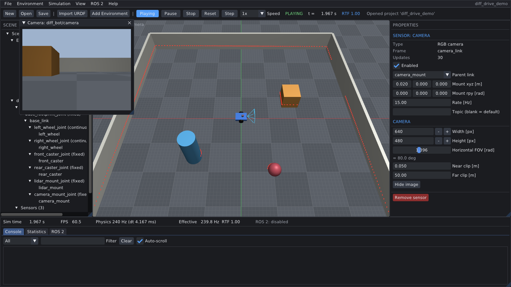
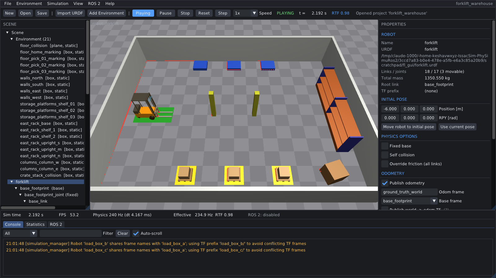

# Lightweight Robotics Simulator

A small robotics simulator for ROS 2 development. It uses PyBullet for the physics, a custom OpenGL renderer for the 3D view, and a native ROS 2 bridge. The simulator imports URDF robots and publishes standard ROS 2 messages. Thus, you can use it with Nav2, SLAM, localization and perception nodes.



## Story time

During my bachelor's degree, I had a MacBook Air with an Apple M1 chip. I used Asahi Ubuntu in a dual-boot configuration to run Linux on it. On this Linux installation, I used ROS 2 on my ARM-based laptop.

At that time, Gazebo did not have good support for ARM chips. Thus, I could not simulate my robots on my own laptop. To solve this problem, I wrote a very basic simulator that ran on ARM.

This repository contains a new version of that simulator. I made it again with a better architecture, more features and tests. I now publish it as open source. I hope that it helps other people who cannot use Gazebo on their computers, or who need a simple and fast simulator for ROS 2.

## Features

| Area | Function |
|---|---|
| Physics | PyBullet in DIRECT mode, fixed timestep (default 240 Hz), independent of the frame rate |
| Robots | URDF import: fixed, revolute, continuous and prismatic joints, mimic joints, box, cylinder, sphere and mesh geometry (STL, OBJ, DAE), `package://` paths |
| Motors | Two types: rotational and linear. Position, velocity and effort control |
| Sensors | Three types: RGB camera, perfect IMU and 2D LiDAR |
| Rendering | OpenGL 3.3 core, textured meshes, sensor overlays, collision view |
| User interface | Dear ImGui: scene hierarchy, properties, console, camera windows, environment editor |
| ROS 2 | Joint states, TF, odometry, sensor topics, `cmd_vel`, joint commands, `/clock`, simulation services |
| Projects | JSON project files with robots, motors, sensors, environment and settings |
| Headless mode | Runs without a window, for servers and CI |

The simulator works without ROS 2. If ROS 2 is installed and sourced, the ROS 2 bridge starts.

## Quick start

These instructions are for Ubuntu 24.04 and ROS 2 Jazzy. ROS 2 is optional.

1. Get the source code:

   ```bash
   git clone https://github.com/keshavwxyz/lightweight-robotics-simulator.git
   cd lightweight-robotics-simulator
   ```

2. Make a Python virtual environment. Use `--system-site-packages`, so that `rclpy` from ROS 2 stays available:

   ```bash
   python3 -m venv --system-site-packages .venv
   source .venv/bin/activate
   pip install -r requirements.txt
   ```

3. Start the simulator with an example project:

   ```bash
   ./run.sh --project robot_simulator/examples/differential_drive_robot/project.json --play
   ```

4. Send a velocity command from a second terminal (ROS 2 only):

   ```bash
   source /opt/ros/jazzy/setup.bash
   ros2 topic pub /diff_bot/cmd_vel geometry_msgs/msg/Twist "{linear: {x: 0.3}, angular: {z: 0.5}}"
   ```

Other start options:

```bash
./run.sh                                   # empty scene
./run.sh --urdf path/to/robot.urdf         # import a URDF robot
./run.sh --no-ros                          # do not start the ROS 2 bridge
./run.sh --headless --project project.json # no window
```

## Use the simulator with your ROS 2 project

You can run an existing ROS 2 project, for example a Gazebo project, on this simulator. You do not change the nodes of your robot software. You replace only the simulator interface. The [porting guide](docs/porting_guide.md) gives the procedure step by step.

I used this procedure to run a full warehouse forklift project (Nav2, AMCL, QR perception, pallet handling and a two-robot fleet). The mission results were the same as in Gazebo.



## Documentation

| Document | Contents |
|---|---|
| [User guide](docs/user_guide.md) | Installation, user interface, URDF support, motors, sensors, ROS 2 interface, projects, configuration |
| [Porting guide](docs/porting_guide.md) | How to run your existing ROS 2 project on the simulator |
| [Package overview](robot_simulator/README.md) | Source code structure |
| [Contributing](CONTRIBUTING.md) | How to report problems and send changes |
| [Changelog](CHANGELOG.md) | Changes for each version |

## Repository layout

```
├── run.sh                  start script (sources ROS 2 and the virtual environment)
├── requirements.txt        Python dependencies
├── docs/                   user guide, porting guide, images
└── robot_simulator/        source code, example robots and projects, tests
```

## Tests

```bash
source /opt/ros/jazzy/setup.bash   # optional: without ROS 2, the ROS tests are skipped
source .venv/bin/activate
PYTHONPATH=$PWD:$PYTHONPATH python -m pytest robot_simulator/tests -q
```

The tests that need a display (camera images) are skipped if no display is available.

## License

Apache License 2.0. Refer to [LICENSE](LICENSE).
